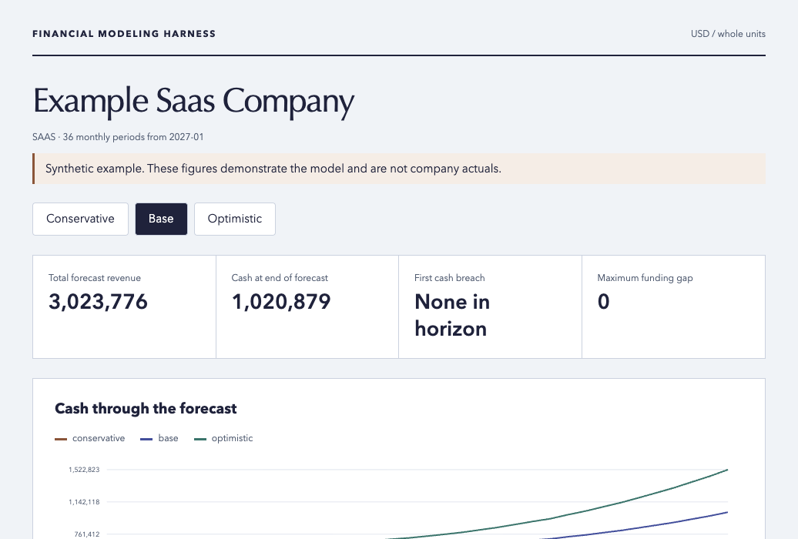

# Financial Modeling Harness

A runnable financial modeling specialization of [Vertical Harness](https://github.com/harshith-vaddiparthy/Vertical-Harness), combining the startup-planning concepts in [wshobson's startup-financial-modeling](https://www.skills.sh/wshobson/agents/startup-financial-modeling) and the integrated-statement concepts in [Claude Office Skills financial-modeling](https://www.skills.sh/claude-office-skills/skills/financial-modeling).

Hermes supplies the reasoning and conversation. This repository supplies a deterministic financial engine, validated inputs, scoped tools, domain rules, private run evidence and a reusable specialist skill. It runs locally without model API credentials and connects to Hermes through its native skills and stdio MCP support.



*Original synthetic example, inspected on desktop and mobile. No company financials are included.*

## Start with a working model

Python 3.10+ is the only core dependency. No package installation or cloud account is required.

```bash
git clone https://github.com/harshith-vaddiparthy/Financial-Modeling-Harness.git
cd Financial-Modeling-Harness
python3 -m harness doctor
python3 -m harness run examples/saas.json
```

The command returns a run ID, report path and summaries. Open the returned `report.html` in your browser. The report works offline and shows all three cash curves, a scenario selector, annual results, monthly statements, active drivers and input provenance. On macOS, double-click `Open Financial Model.command` to generate, verify and open the synthetic demonstration.

```bash
python3 -m harness verify RUN_ID
python3 -m harness init --model corporate --output workspace/my-company.json
python3 -m harness validate workspace/my-company.json
python3 -m harness run workspace/my-company.json --scenario all
python3 -m harness sensitivity examples/saas.json \
  --driver monthly_churn --values '[0.01, 0.02, 0.03]'
```

`init` creates a **synthetic** starter and refuses to overwrite existing files. Replace its inputs and sources for a real company. Read [the input contract](skills/financial-modeling-harness/references/input-contract.md) before converting company data. Choose `saas`, `corporate`, `marketplace`, `ecommerce` or `services`; all five original examples are included.

## What the engine implements

- Up to 60 monthly periods, with calendar-year summaries that sum flows and retain ending balances.
- SaaS cohort retention, expansion, MRR/ARR, fully loaded CAC, simple LTV, payback, NRR and burn multiple.
- Corporate revenue growth, marketplace GMV/take rate, ecommerce traffic/conversion/AOV, and services capacity/utilization.
- Hiring by role, department and employment dates, salary growth, and loaded compensation.
- Linked income statement, balance sheet and cash flow, with receivables, inventory, payables, PP&E and average-debt interest.
- Explicit equity raises, simple priced-round dilution, debt issuance/repayment and dividends.
- Conservative/base/optimistic scenarios and full-model sensitivity recalculation.
- Strict missing-input and provenance validation. An unbalanced opening balance sheet fails the run.
- Seven independently reviewed accounting identities each month. Negative cash remains visible and creates a funding-gap warning.
- JSON, monthly/annual/cohort CSV, Markdown and a portable interactive HTML report. CSVs are spreadsheet-compatible snapshots; this version does not author an editable Excel workbook.

The core has no external finance accounts, bank connections, market-data API, automatic funding plug, or money-transfer tool. General tax, annual-contract deferred revenue, SAFEs, options, complex capital structures, multicurrency, and inventory purchasing schedules require domain extensions. [The accounting rules](domain/rules.md) define the simplifications.

## Connect your Hermes agent

Read [Hermes integration](skills/financial-modeling-harness/references/hermes.md). The repository includes a discoverable skill and six MCP tools:

`finance_doctor`, `finance_validate`, `finance_run`, `finance_verify`, `finance_get_summary`, `finance_sensitivity`.

```bash
python3 scripts/install_skill.py --target hermes
hermes mcp add financial-modeling-harness \
  --command /absolute/path/Financial-Modeling-Harness/scripts/mcp-server.sh
hermes mcp test financial-modeling-harness
```

Check `hermes mcp add --help` for the flags supported by your Hermes version. The helper launcher changes into this checkout, so MCP works regardless of the agent's current directory. Set `FINANCIAL_HARNESS_WORKSPACE` to a private workspace path for that server. Registration adds this server only; it does not select a provider or change model credentials.

Use this request in a **new Hermes session**:

> Use financial-modeling-harness to build a 36-month SaaS plan for my company. First identify the missing opening balances and forecast drivers. Separate actuals from assumptions. Run conservative, base and optimistic scenarios, verify the run, and show cash-breach timing, funding need, hiring costs, unit economics and the report path. Use the saved model for a churn sensitivity analysis.

For a quick demonstration, replace “my company” with “the repository's synthetic SaaS example.” Shell access also works through `python3 -m harness`; MCP is optional for standalone use.

## Harness map

| Layer | Implementation |
| --- | --- |
| Specialist skill | [skills/financial-modeling-harness/SKILL.md](skills/financial-modeling-harness/SKILL.md) |
| Domain | [domain/brief.md](domain/brief.md), [rules](domain/rules.md), [output contract](domain/output-contract.md) |
| Models | Reasoning stays in the caller's existing agent; calculations use [harness/engine.py](harness/engine.py) |
| Tools and access | CLI, stdio MCP, validated model objects, bounded horizon, private workspace |
| Context | Company inputs with per-input sources; upstream guidance pinned in `vendor/` |
| Workflow | [workflows/primary.md](workflows/primary.md) |
| Evaluation | [tests/](tests/), [evals/cases.jsonl](evals/cases.jsonl), [rubric](evals/rubric.md) |
| Operations | [runbook](operations/runbook.md), [verification evidence](operations/verification.md) |

This uses the same independent-repository pattern as [3D Printing Harness](https://github.com/harshith-vaddiparthy/3D-Printing-Harness) and [Android TV Harness](https://github.com/harshith-vaddiparthy/Android-TV-Harness). The parent template links back to this specialization under its examples directory.

## Evidence and integrity

Each `workspace/runs/RUN_ID/` contains `input.json`, `results.json`, reports/CSVs and `manifest.json`. The manifest binds the input, engine source and output artifact hashes. `verify` checks file hashes, recalculates the financial model and reviews the statement identities. These are local integrity checks, not signatures or evidence of external approval. Workspace files are excluded from Git and created with restricted permissions. Abandoned incomplete directories have no completed manifest and cannot pass verification.

```bash
python3 -m unittest discover -s tests -v
python3 scripts/check_bundle.py
```

CI runs the same tests on Python 3.10, 3.12 and 3.13. Fresh integration results belong in [operations/verification.md](operations/verification.md).

## Source and license

Original harness code and examples: [MIT](LICENSE). Upstream skills are retained unchanged at pinned commits, with their own MIT licenses and checksums. See [THIRD_PARTY_NOTICES.md](THIRD_PARTY_NOTICES.md) and [vendor/sources.lock.json](vendor/sources.lock.json). Their suggested providers, tools, ratios and example numbers are reference material, not installed services, mandatory benchmarks or company actuals.
